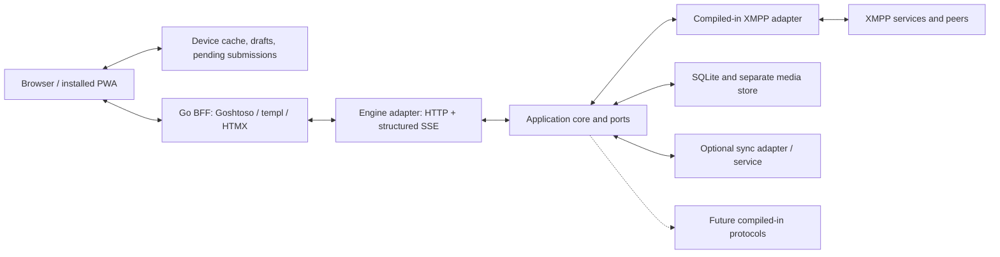

# Oiê first specification

Draft 1 · 2026-11-07 · Intended repository: `araihu/oie`

Oiê is a single-owner, multi-account chat application written in Go, with a Goshtoso web interface and protocol adapters behind a hexagonal application core. The alpha implements XMPP, runs with a local or hosted native Go engine, and optionally synchronizes independent local engines through a user-hostable service.

The experience should feel close to WhatsApp: a familiar conversation list, message timeline, composer, media cards, room details, and settings. The user's explicit Oiê decisions take precedence over WhatsApp behavior. For unresolved user-facing choices, prefer WhatsApp-like behavior where it fits the selected protocols and deployment modes. Do not infer WhatsApp's internal architecture or copy every WhatsApp feature into scope.

## 1. Decision status and scope

This draft consolidates the [discussion record](unified-chat-discussion.md) and [formatting feasibility report](oie-formatting-feasibility.md). Later explicit decisions supersede earlier proposals in those notes.

The status labels have distinct meanings:

| Label | Meaning |
| --- | --- |
| **AGREED** | Confirmed product requirement or architectural decision. |
| **RECOMMENDED Rxx** | Proposed implementation or product default, not yet separately accepted. |
| **OPEN Oxx** | A choice or precise contract still needs resolution. A linked recommendation is a starting point. |
| **BACKLOG Bxx** | Explicitly deferred from alpha. |

Sections 2–13 describe **AGREED** behavior unless a paragraph carries a recommendation or open-decision label. Section 14 contains recommendations, not additional accepted scope. Acceptance scenarios distinguish agreed outcomes from proposed engineering details.

The broader alpha target includes local standalone operation, hosted-engine operation, optional app/history sync, multi-account XMPP, reliable immediate and scheduled sends, retained searchable history, rooms, attachments, responsive web UI, PWA/offline behavior, and manual merge restore. The current source prerelease is v0.0.1-rc.0, with the implemented functional scope and ongoing standalone desktop packaging agreed in section 2.1.1. The first alpha, v0.0.1, additionally requires the initial-history usability improvement tracked as B25. This does not claim that every broader alpha requirement is already implemented.

Alpha is single-user: one Oiê owner per instance. Multiple accounts and devices remain supported. Built-in application authentication, multi-user hosting, XMPP E2EE, calls, and other deferred features are listed in section 16. Protocol account credentials are still needed to connect existing XMPP accounts; this does not reopen the deferred application-login design.

No specific XMPP client, SQLite driver, browser database, UUID library, Go toolchain version, or final library dependency set is selected by this draft.

## 2. Deployment and application boundaries

### 2.1 Runtime and packaging

Ship one Go executable supporting native engine, presentation/BFF, and optional sync-service roles. Use a data directory containing SQLite data and separate media files. SQLite is the alpha persistence choice for local engines, hosted engines, and the sync service.

| Mode | Protocol sessions and authoritative engine store | Device behavior |
| --- | --- | --- |
| Local without sync | Native Go engine on the user's machine, with SQLite and separate media files. | App-owned data can diverge from other independent engines. |
| Local with optional sync | Each local engine owns its sessions/store; an optional service exchanges selected app data and retained history. | Devices can operate with different preferences and temporarily divergent data. |
| Hosted engine | A native Go engine owns sessions/store on the host. | Device UIs share the engine's account state; drafts, cache, and device preferences remain device-specific. |

Each device/UI selects **one engine at a time**, supporting multiple accounts within that engine. The alpha UI does not simultaneously aggregate multiple independent engines. An engine's replicated history can still contain data obtained from other synced engines.

Use an embedded engine initially, with no separate daemon required. In a future native window host, closing the window keeps the engine running; explicit quit stops it. In the browser-first alpha, closing a tab does not stop the serving Go process. Closing a hosted UI does not terminate its shared remote engine. Wails is now selected for the first standalone desktop alpha, as described below; this supersedes the earlier browser-only release boundary.

Ordinary engine restart/reconnect resumes eligible pending sends automatically. Backup recovery has a separate review rule in section 13.

**OPEN O01:** Exact commands, configuration, role combinations, process supervision, and data-directory layout. **RECOMMENDED R01:** a modular monolith with explicit role configuration.

### 2.1.1 First desktop release candidate and alpha distribution · 2026-11-10

**AGREED:** the current source prerelease is **v0.0.1-rc.0**. The current
functional baseline and desktop packaging work continue. The first alpha remains
**v0.0.1** and must include B25, usable room history during initial recovery.
The existing recovery experience is accepted for rc.0. This explicitly extends
the earlier functional freeze at `741e794` for the alpha; it does not require
implementing B25 during the current packaging work. The larger specification
remains the product direction, not a claim that sync, schedules, outgoing media,
PWA/offline queues or every other planned feature ships in these versions.

**AGREED:** use Wails as the native window host, retaining the Go engine, local
SQLite/media storage, Goshtoso/templ BFF and HTMX interface. Initial validated
release targets are macOS Apple Silicon (`darwin/arm64`) and Ubuntu Linux x86_64
(`linux/amd64`). Windows and other architectures are outside this initial
validation matrix. Closing the window keeps the embedded engine running;
explicit Quit stops it.

**AGREED:** initially distribute through both source installation with
`go install` and one macOS/Linux shell installer. The installer downloads the
matching prebuilt artifact from `araihu/oie` GitHub Releases after detecting OS
and architecture. Package-manager distribution is deferred as B22.

**RECOMMENDED:** pin Wails v3.1.0, the latest stable release verified on
2026-11-10, consistently in app dependencies and the tools module. The Wails CLI
belongs in the tools module. Keep generated frontend assets available in source
so `go install` does not depend on an implicit generation step. Source builds
still require the native platform toolchain and libraries; `go install` does not
produce a macOS application bundle by itself.

**IMPLEMENTED:** `cmd/oie-desktop` uses Wails v3.1.0 with the existing embedded
engine and HTMX BFF. The stable native origin preserves drafts across launches;
the host adapts cookies, native file saving, external links, close-to-hide and
explicit Quit. The browser/server command remains available. Build and scope
details are in [desktop integration](desktop.md). The source tag v0.0.1-rc.0
records this behavior; B25 is not implemented by that tag. The subsequent
packaging increment publishes rc.0 archives and a per-user shell installer for
macOS Apple Silicon and Ubuntu Linux x86_64. The original tag remains fixed;
packaging-tooling provenance and validation scope are recorded separately in
the release receipt. The v0.0.1 alpha has not been published.

**AGREED:** default to installation for the current OS user. On Ubuntu, check
for missing runtime dependencies and show the required installation commands;
the installer does not install them or invoke `sudo`. Updating is manual through
the same installer, preserving the separate database, media and preferences.
Source installations can be updated through `go install`. Automatic in-app
updates are deferred as B23.

**AGREED:** the first macOS alpha ships without Developer ID signing or
notarization.

**AGREED:** FFmpeg remains an optional external dependency, installed separately.
Its absence must not prevent installation or normal app startup. Locally
generated video thumbnails require it; video playback remains independent and
subject to the formats supported by the platform WebView. The installer can
identify a missing optional FFmpeg executable and provide installation guidance,
without downloading or installing it automatically.

**RECOMMENDED:** retain any ad-hoc executable signing required by the native
build tooling and document Apple's manual first-open procedure. The installer
should not silently remove quarantine attributes or disable Gatekeeper.

**RECOMMENDED:** publish simple archives, with a macOS `.app` bundle and a Linux
executable plus desktop resources. Verify release checksums and support selecting
a pinned release.

**IMPLEMENTED:** rc.0 uses a macOS `Oie.app` archive and a Linux `bin`/`share`
archive. `install.sh --version VERSION --prefix DIR` verifies SHA-256 before
installation. Defaults are `~/Applications/Oie.app` on macOS and `~/.local` on
Linux. Updates preserve the separate data directory. The installer checks
runtime dependencies without installing them and rejects unsafe archive paths.
Native package checks cover installation, launch, engine initialization and
reinstallation with retained data. See [installation](installation.md) for the
exact assets, dependencies, removal procedure and tested environments.

**OPEN:** the minimum Ubuntu/macOS versions beyond the tested environments. The
available development environment reports Ubuntu 26.04; this does not establish
the supported minimum version. Native routing, CSRF, SSE and partial media reads
have desktop smoke coverage. Separate custom profiles on macOS still share
Wails' default native website store; engine-specific drafts/cache do not establish
complete native storage isolation.

Reference evidence: [Wails v3.1.0 release](https://github.com/wailsapp/wails/releases/tag/v3.1.0),
[native prerequisites](https://v3.wails.io/getting-started/installation/),
[build/package behavior](https://v3.wails.io/guides/build/building/) and
[Apple manual first-open guidance](https://support.apple.com/en-us/102445).

### 2.2 Hexagonal architecture

The application core owns messaging rules, identity, revisions, history policy, schedules, outbox transitions, and synchronization semantics. Protocol clients, persistence, transports, and presentation sit behind or implement application-owned interfaces.

The engine exposes structured operations, queries, capabilities, and events. It does not return Goshtoso components or HTML. The BFF owns templ/Goshtoso rendering, browser routes, HTMX fragments, and presentation updates derived from engine events. The frontend contains no XMPP, Matrix, IRC, or Nostr client.

The diagram describes logical boundaries, not mandatory separate processes:

Alpha uses **HTTP commands/queries and structured SSE live events**. Follow API-first development: define the HTTP contract in OpenAPI, lint with vacuum, and generate supported Go types/bindings with oapi-codegen. Streaming payloads, reconnection, and recovery need an explicit contract alongside generated bindings.

Keep application contracts independent of wire transport. Future WebSocket, IPC, Unix-socket, daemon, and WASM adapters must preserve operation semantics. An ordinary browser needs an intermediary to use a Unix socket; HTTP itself can be carried over a Unix socket behind such an intermediary.

**RECOMMENDED R02:** narrow application ports and protocol feature interfaces, with transport adapters translating into the same use cases. **RECOMMENDED R03:** stable operation IDs, revision preconditions, and recoverable event subscriptions.

## 3. Accounts, contacts, rooms, and capabilities

### 3.1 Protocol scope and effective capabilities

XMPP is the initial implementation. Matrix, IRC, and Nostr are likely future candidates and design references, without an agreed implementation order. Alpha adapters are compiled-in Go packages registered at startup; adding one requires a rebuild. Independently installable plugins are backlogged.

Discover capabilities and expose effective application capabilities at the relevant account, peer, room, message, or conversation scope. Availability may depend on the adapter, protocol server, receiving client, permissions, content format, or selected runtime. It is not a single server-wide boolean.

The BFF uses application capabilities; protocol namespaces and stanza handling remain in adapters. Optional operations include history retrieval, room discovery/creation, invitations, name/topic changes, attachments and limits, replies, corrections, retractions, reactions, formatting, receipts, typing, and presence.

**RECOMMENDED R04:** distinguish unsupported, supported, permission-denied, and temporarily unknown/unavailable states; revalidate at operation time. **OPEN O02:** the complete capability schema and minimum tested XMPP interoperability matrix.

Account management retains priority in the account sidebar. A deeper capabilities page shows a comparison of Oiê implementation, protocol support and discovered server support, followed by server/entity discovery details. Unknown evidence, unadvertised features, app-only features and peer/room-specific support remain distinct. Server advertisements never imply that Oiê implements an operation or that a room permits it. This diagnostic report is a bounded session snapshot; reading it does not probe the protocol server.

### 3.2 Accounts and contacts

Support multiple simultaneous existing XMPP accounts, such as personal and work. Display the owning/sending account clearly in conversations and account-sensitive actions. In-app XMPP registration is backlogged.

Recover available account, peer and room profile images from the protocol. Cache
images locally and use initials when an image is absent or inaccessible. Room
speaker nicknames alone do not establish a person's identity for image lookup.

**IMPLEMENTATION SCOPE:** the sender drawer reads published XMPP vCard `FN`,
with structured `N` as fallback, through a bounded account/session cache. A
profile's self-declared `JABBERID` never establishes the author. Personal
addresses are retained separately from message content when authenticated MAM
metadata discloses them, or when a fresh message matches authorized presence in
a confirmed non-anonymous room. Contradictory evidence suppresses identity.
Older messages without such evidence remain undisclosed until verified archive
re-observation; opening a profile does not force archive recovery. Published
full names are optional and are not verified legal identities.

Use a profile control at the bottom of the navigation for account switching, following the supplied X account-switcher reference. Its popover lists account names/addresses, marks the active account, shows available unread counts, and offers adding an existing account and managing connections. Account connection status appears on the avatar with a localized tooltip and accessible label, and updates without closing the switcher. Retain an All accounts inbox option. Switching the inbox account does not disconnect other protocol sessions, transfer drafts, or change pending-send ownership. Oiê uses Disconnect for an XMPP session; built-in application login/logout remains backlogged. Account management starts with a compact account list and opens only one account’s connection details at a time. The account detail avatar also carries connection status, replacing a separate status panel. Connected or connecting accounts offer Disconnect without the connection form; disconnected accounts and failed connections offer the connection form. Live refreshes update these actions while preserving unfinished connection fields when the state stays the same. Adding an existing account is a separate screen; server/port overrides live under advanced connection settings. In the account-list drawer, Add account remains at the bottom while the account list scrolls independently above it.

An Oiê contact can group multiple protocol identities. Link identity and Unlink identity are manual, reversible operations. Each account/protocol conversation retains its own timeline; linking does not merge histories or retarget pending sends.

Support per-account contact add/remove and contact-request acceptance/decline where the protocol permits. Removing a contact preserves retained conversation history. Provider contact/presence subscriptions remain distinct from app-owned aliases and identity grouping.

**IMPLEMENTATION SCOPE:** global search reads saved per-account XMPP roster
contacts. The native adapter refreshes this cache on connection and authorized
roster pushes; searching itself makes no provider request. Cache identities and
observed revisions persist through reconnect/restart, and removal preserves saved
chat history. Contact mutation controls, identity linking and app sync remain
separate work. See [saved protocol contacts](contacts.md).

Allow starting a direct chat by address without first adding a contact, where permitted, with the sending account clearly selected. Neither sending nor receiving a message automatically adds a contact, requests presence access, or links identities.

Incoming non-contact chats appear in the normal conversation list with a localized **Not in contacts** label. Blocking/unblocking is backlogged; conversation muting is not a protocol block.

### 3.3 Rooms

Support, subject to protocol support and permissions:

- Public-room discovery and joining by room address.
- Creation of group rooms.
- Sending invitations and accepting/declining received invitations.
- A room-details panel with name, topic, and the available participant list.
- Name/topic editing where permitted.

Do not imply that an available participant list is a complete persistent membership roster. Conversation details show available room metadata, visible occupants and connection/presence observations with their scope. The owning account connection is separate from room-session and participant presence. Missing observations remain unknown. Reading details does not automatically join a room or request presence subscriptions.

Rejoin previously active rooms after reconnecting unless the user explicitly left or access was revoked. Preserve explicit leave decisions across restart. Leaving a room does not delete stored history. Leave room is a direct conversation-menu action with a leading icon. It is disabled while pending or inactive; an uncertain result opens the room controls for recovery. Room-session status and other join/leave/refresh controls are accessed on demand through the conversation action menu, rather than in a persistent block above the message timeline. Opening those controls does not change the room session. Kicking, banning, and role-management controls are backlogged; incoming removal/permission changes still need truthful handling.

**AGREED:** on account connection, honor modern and legacy XMPP bookmarks marked
`autojoin=true` or `1`. When no local room intent exists, create an initial join
intent using the account username as nickname. Existing manual nickname choices,
explicit leaves and access revocation take precedence over imported bookmarks.
The server must still confirm this client's room presence; another client's
participation does not establish it. See [bookmark autojoin](bookmark-autojoin.md).

**OPEN O03:** room creation defaults, protocol-specific leave/rejoin behavior across independent engines, and the exact representation of participants and memberships.

## 4. Identity, revisions, and merge semantics

Application entities and revisions use **UUIDv7** identifiers, preserved through sync and backup/restore. Protocol identifiers remain separate, scoped external references. UTC is used internally; timezone conversion belongs to presentation.

Persistent content revisions are immutable and have their own revision UUIDs and parent revision references. Message edit history consists of the versions Oiê actually received/stored. A conversation references the stable logical message UUID and displays its derived current revision.

Select current message revisions as follows:

1. A descendant supersedes its ancestor, even when device clocks disagree.
2. Among genuinely concurrent revision heads, choose the most recent revision creation timestamp in UTC.
3. Break equal-timestamp ties deterministically by revision UUID.
4. Preserve alternate revisions for history.

Import/receive time must not make an old revision win. A cached current-revision pointer is a projection of these rules, not an independently authoritative collection of `is_current` flags. UUIDv7's embedded timestamp does not substitute for ancestry or conflict metadata.

For ordinary shared preferences and contact fields, resolve conflicts automatically **per field**, preserving independent edits to different fields. Message revisions, deletion markers, read state, and outbox ownership retain their own rules. Do not apply unrestricted whole-entity last-writer-wins to every state machine.

Sync and backup merge use the same type-specific conflict/deletion policies. A merge must not replay a message to its protocol provider merely because a historical record arrived.

**RECOMMENDED R05:** a common revision envelope with entity ID, revision ID, parent IDs, originating engine/device, authored UTC time, schema/profile version, and source/protocol provenance, with type-specific payloads.

**OPEN O04:** canonical identity when independent engines observe the same provider message before syncing. UUIDs alone do not make two independently created local records the same message. Provider-ID matching, revision deduplication, aliases, and missing provider ancestry require a concrete design.

## 5. Outgoing messages and scheduling

### 5.1 Durable acceptance and delivery evidence

Use a **transactional outbox**: durably commit the outgoing message and send intent together in the accepting engine's database. Immediate sends become eligible immediately, with no artificial undo delay. Retry recoverable failures and resume after ordinary restart/reconnect.

The guarantee is durable committed intent and eventual submission under recoverable failures while the owning engine runs and the provider is available, unless cancelled. This is not an unconditional guarantee of recipient delivery or exactly-once external delivery.

Keep these milestones distinct:

- Device-local pending submission: explicit Send has been saved in the UI device, but engine acceptance is not confirmed.
- Engine acceptance: message/send intent committed in its transactional outbox.
- Dispatch/in-flight: a provider attempt has begun.
- Provider acceptance: evidence as defined by that adapter.
- Recipient delivery and read evidence: distinct optional protocol milestones.
- Unknown outcome or permanent failure: explicit, actionable states rather than inferred success.

Missing optional delivery/read receipts must not trigger indefinite resending of an otherwise accepted message.

**AGREED:** pending outgoing bubbles are faded, without a visible progress label. Restore normal opacity when protocol submission is confirmed. Show send states as compact accessible icons beside the time inside the bubble, retaining recovery through an icon or the message menu. Do not add a status box or row below the bubble. Engine acceptance alone does not imply protocol submission or recipient delivery.

### 5.2 Mutation cutoff and races

| State/evidence | Cancel, edit pending content, or reschedule |
| --- | --- |
| Scheduled, queued, or waiting for retry with known-unsent status, before dispatch | Allowed through an atomic engine-side guard. |
| Dispatch has started or the original transmission is in flight | Reject the mutation and return actual status. |
| A previous transmission may have been accepted, but its outcome is unknown | Preserve uncertainty; do not present this as a safely unsent item. Reconciliation policy is open. |
| Provider-accepted/delivered/read | Pending-send mutation no longer applies. Supported correction/retraction is a separate operation. |
| Successfully cancelled before dispatch | Terminal; ordinary restart, backfill, sync, or restore must not revive that cancelled intent. |

The engine enforces the cutoff, including stale UI state and races with dispatch. A hidden/disabled UI control is not the guard.

**RECOMMENDED R03:** durable idempotency keys for submissions, operation lookup after lost responses, and revision/state preconditions on mutations. Repeated requests must not create another logical send. The API's exact status codes/envelopes are **OPEN O05**.

### 5.3 Scheduling and ownership

Persist a scheduled send as a future send intent with a UTC not-before instant. Timezone conversion affects input/display, not the scheduled instant. Changing device timezone does not move an existing schedule.

If the time is missed because the engine was stopped, asleep, offline, or disconnected, send as soon as that owning engine is available and connected again, unless cancelled. No overdue approval step or automatic expiry has been selected.

Show pending/scheduled items across synced devices, including their owning engine and potentially stale status. Initially, editing/rescheduling/cancelling from another device requires reaching that engine for authoritative confirmation before dispatch. Multiple UIs using the same reachable hosted engine can already act through it.

This reachability restriction is temporary. Full centralized sync should eventually support pending-send control from any synced device without requiring the original local engine to be directly reachable. That coordination is backlogged; alpha replication must not create a second dispatcher.

**RECOMMENDED R06:** separate send ownership from replicated visibility, select eligible work without letting a future schedule block an immediate send, and reconcile ambiguous provider outcomes before retrying.

**OPEN O06:** permanent-failure recovery, ambiguous acceptance, ordering of eligible sends, staged-upload cutoff, and explicit engine migration/ownership transfer. Recurring schedules are not selected.

### 5.4 Explicit Send while the UI is offline

When the PWA cannot reach its selected engine, an explicit Send saves a durable device-local pending submission and automatically submits it when the engine becomes reachable and the client runtime executes again. Display **Waiting for connection** until engine acceptance is confirmed.

Composing/saving a draft alone never auto-sends. Drafts remain device-specific even when UIs share a hosted engine.

**RECOMMENDED R03/R09:** allocate an operation ID before the first attempt and bind it to the selected engine/account/destination. If a request might have reached the engine before the response was lost, reconcile by operation ID before resubmitting or promising cancellation. Only an entirely unsubmitted item can be edited/cancelled purely locally without that engine check.

The closed browser is not assumed to run a persistent background dispatcher. Switching engines must not silently submit the same pending operation to another owner.

## 6. Sent-message actions and formatting

Star or unstar a retained source message from the timeline or its image viewer.
All images attached to that message share its star. This is app-owned metadata,
independent of protocol support, conversation favorites, and message content edits.

**AGREED:** inside chat bubbles, show a passive star beside the message time only when the message is starred. The indicator is not clickable or keyboard-focusable. Star and unstar actions in the chat are accessed through the message-actions chevron; the image viewer retains its separate action.

The message-actions chevron sits inside the upper-right corner of its own bubble,
with space reserved so it does not cover the sender, timestamp or message content.
It remains available through keyboard focus and touch, and the opened menu stays
within the visible viewport.

Support quoted replies with referenced sender/excerpt and a stable message reference. This does not select separate threaded timelines.

Allow the user to edit their own sent messages where supported and permitted, displaying **Edited**. This is a new protocol correction operation, not mutation of an in-flight original send. Preserve observed previous versions behind **View edit history**; Oiê cannot recover versions it never obtained.

Support emoji reactions where supported, using provider-normalized targets and restrictions.

Support retraction of the user's own sent messages where supported, with a distinct **Retract message** action and a removed-message placeholder. Show real request/failure state; removal of other clients' copies cannot be guaranteed.

Retain already-stored retracted messages, including incoming retractions, behind **Message retracted** and **Reveal original**. Retraction does not perform Oiê history deletion.

Allow manual forwarding across conversations/accounts using the destination account and its capabilities. Forward as a new outgoing message through that account's outbox. Use a generic **Forwarded** label where supported. Original sender/conversation attribution is omitted unless explicitly chosen. This does not select automatic cross-protocol relaying.

Forwarding media retrieves the full file if necessary and uploads through the destination account, with progress and clear errors. Do not silently substitute a source URL. Explicit forwarding authorizes retrieval of that selected file independently of automatic incoming download preferences.

### 6.1 Markdown and Copy

Use `araihu/margo` with its current syntax/parsing behavior for this alpha subset: bold, italic, strikethrough, inline code, fenced/preformatted code, links, lists, and blockquotes. WhatsApp is a feature/presentation reference; it does not replace Margo's delimiter grammar.

**AGREED:** in chat, each quoted line needs its own `>` prefix. An unprefixed response immediately after a quote renders outside it, including an emoji-only response. Reducing the number of prefixes reduces the nesting depth. Use an opt-in public Margo chat option for this exception; preserve Margo's default document and chat parsing behavior. Code remains literal, and presentation never changes the original message or its copy source.

Attempt Markdown rendering by default, with an option to disable it and a readable fallback on rendering failure. Preserve the original message source separately from rendered output.

Adapters translate semantic formatting to supported provider representations, falling back readably for unsupported features. Formatting support is not uniformly a server capability.

Copy always writes original message content as `text/plain`, preserving Markdown markers. For example, `**hello**` copies literally as `**hello**`. Copy rendered text without markers is backlogged.

Needed public Margo API additions are authorized, provided existing behavior is preserved. The feasibility report identifies a gap in public semantic spans/blocks and restricted chat-profile support; do not import parser internals or scrape rendered HTML for protocol encoding.

**RECOMMENDED R07:** an additive Margo semantic projection/chat profile and readable text projection, preserving literal chat content and safe rendering. **OPEN O07:** exact public APIs, treatment of unsupported document syntax/newlines, rendering-toggle scope, and protocol mappings.

## 7. History, search, and shared links

Persist history independently of protocol-server retention. By default,
gradually backfill **all available authorized history** with paced, serial
requests per server. Allow on-demand recovery per room. Both modes load the
initial history target and retain new messages and retrieved pages. For XMPP,
key the queue by the normalized domain of the archive address. Rooms on the
same domain share its limits across accounts. Different domains can recover
history in parallel. Serve retained history when reopening a conversation.

Keep retrieved history until explicit user deletion, even after the provider expires it. Optional Oiê history sync also transfers records no longer available from the provider. Oiê cannot retrieve history that neither the provider nor a participating Oiê store still possesses.

**RECOMMENDED R08:** a bounded, paced backfill queue with checkpoints, resumable pages, backoff, foreground/live-message priority, and explicit partial-history status. Scope serialization and limits deliberately rather than launching one unbounded worker per room.

**AGREED RELEASE REQUIREMENT:** B25 is required before alpha v0.0.1, while
rc.0 may retain the current initial-recovery behavior. Initial room recovery
must let the user interact while older authorized history continues in the
background. **AGREED INITIAL TARGET:** prioritize the last 48 hours for each
room. Fix the window when recovery starts for that room, persist both bounds
in UTC and reuse them when resuming. If that interval contains fewer than 128
messages, include immediately preceding messages until reaching 128 or
exhausting the available authorized archive. Start with the newest page of the
open room when it needs recovery, then alternate pages among rooms on each
server with preference for the open room. Show each page as it is stored. Fetch
older history gradually in the default mode or as needed for navigation and
search in on-demand mode. Advance the cursor after storing the entire page.
If the cursor expires, resume from the inclusive timestamp at the last
confirmed page boundary within the original window and deduplicate reread
messages. Record page limits and turn frequency in
[the initial-history discussion](history-bootstrap-discussion.md).

Search across accounts/sources in the selected engine and within a direct/group conversation. Alpha indexes message text, captions, filenames, URLs, page titles/descriptions, and available media metadata. Document-body extraction, image OCR, and audio transcription are backlogged.

**AGREED:** room text search queries SQLite and the room archive in parallel
when remote text search is supported. Show local results as they become
available and add authorized remote matches as they arrive. Dispatch remote
search after a short typing pause and keep only the latest term queued for
each active room search. Apply responses to the matching search. Retain those
messages with canonical deduplication and track contiguous history coverage
separately. After the current query finishes, give search and scroll requests
the next available turn on that server. Space automatic backfill pages at
least one second apart per server. Search and scroll requests can use that
interval.

**AGREED:** use the existing conversation-list search field as one unified global
search. Remove the separate message-search navigation item and heading action.
Group matching conversations, contacts and messages, with access to matching
shared content. Use the supplied two-search reference for presentation. Global
search shows results in the conversation-list column, alongside the selected
conversation. Search within a conversation uses a bar above its timeline, with
navigation between matching messages and safe highlights of matching text.
Keep the global and conversation queries independent so both can remain active.
Opening a result uses bounded retained-history context rather than loading the
complete conversation into the DOM.

**AGREED:** shared-content search updates while typing, without requiring Enter, and tolerates limited typing errors. Changing a filter also applies the search immediately; these views have no separate Search button. Preserve the text field, focus and caret while replacing results; stale responses must not replace a newer query or screen. Search the retained engine catalog before pagination, rather than only the currently loaded browser page.

**RECOMMENDED R08:** use a 300 ms debounce, accent/case folding, exact substring/prefix matches, and bounded adjacent-transposition edit distance. Allow one edit for terms of four to seven letters and two for longer terms; keep shorter terms and symbols exact. Retain chronological result ordering initially; relevance ranking remains open.

Provide searchable **Media, Files, and Links** views. Catalog shared URLs automatically from messages, including backfilled/synced messages; retain source message/conversation/account context. Here, bookmarks means a shared-link catalog, not an accepted browser-bookmark exporter or independent manual-save feature.

**AGREED:** the main Media and Links destination aggregates all conversations in the selected engine, with account filtering and Media, Links, and Documents tabs. The account filter uses a searchable single-selection combobox, matching account names and addresses and retaining an All accounts option. Its selected value follows the current URL rather than a separate persisted picker state. Show date groups and the source of each item, and provide navigation to its original message. Opening an image keeps the viewer's previous/next navigation scoped to its conversation. Load older catalog items automatically near the end of the scroll area, both globally and in a conversation. Append them without a full-page navigation, preserving the active filters, visible position and video playback. Provide an explicit retry after a failed page load.

Provide WhatsApp-like rich link cards using structured engine metadata. Preview enrichment must not require a provider client in the browser.

**AGREED:** link-card fallbacks prefer the available preview image. Without an image, use a compact card with page title, available description and the domain once. Use a cached site icon when available; otherwise use a local link icon. When metadata is unavailable, show a readable URL path and domain, preserving the full URL as the destination. Do not reserve an empty image column. Keep message cards compact and catalog cards full-width. Metadata failures leave the basic card usable; More options offers an explicit metadata refresh without changing the message.

Search matches the latest message revision by default. **Include edit history** explicitly enables retained earlier versions, with historical matches labeled. Retracted content is hidden from search and Media/Files/Links by default; **Include retracted** enables deliberate retrieval. These filters are independent and never bypass explicit deletion.

**RECOMMENDED R08/R10:** SQLite FTS5 as a derived index; source-linked catalog records; bounded, cached link-preview enrichment independent of history fetching. **OPEN O08:** indexing/tokenization, filters/ranking, preview fetching/refresh policy, cache limits, and provider capability fallbacks.

## 8. Media and downloaded files

Allow media sharing when effective protocol/server capabilities permit. Expose known upload limits and meaningful transfer errors through the uniform API.

**AGREED:** pasting clipboard images/files into the active conversation, or dragging and dropping files onto its chat pane, starts media-message composition. Open an attachment preview where the user can add a caption, remove selected files, or cancel, preserving any existing text draft. Ordinary text paste keeps its normal composer behavior. Pasting or dropping files never sends a message automatically; sending requires explicit activation of Send. Respect the selected account/conversation's effective capabilities and known upload limits, with clear feedback when attachments cannot be sent. Upload staging and multi-attachment delivery semantics remain open under O09.

Incoming images **download automatically as they enter view** by default, configurable per device. Turning automatic image downloads off keeps supplied small previews automatic and full originals on demand; in that mode, do not download an original merely to generate a thumbnail. Other file types keep small previews automatic and full files on demand.

**AGREED:** video cards show a cached static frame behind a centered play control when a preview is available. Prefer a usable small thumbnail supplied with the source message; otherwise the native engine may extract a frame with an optional FFmpeg executable. Generation reads a bounded sample, never retains the original video, and does not start playback. Video preview requests are enabled by default near the viewport, with a per-device opt-out. Global and conversation media catalogs use a common responsive 4:3 preview frame for images and videos; playback preserves the full video within that frame. Manual load and failed-preview retry actions belong in the shared card actions menu. Failed extraction remains explicit and does not trigger repeated automatic retries. Failure leaves playback usable and retry explicit. Preview cache retention and quotas remain open under O09.

Downloaded-file retention is configurable per device and defaults to **retain until explicit deletion**. The PWA's evictable message cache is a separate policy; it does not silently authorize downloaded-original eviction.

SQLite stores attachment references, metadata, and media integrity hashes; binary previews and full files are stored outside SQLite in native deployments. The phrase “only media hash” excludes media blobs from SQLite, not the retrieval/verification metadata the application needs.

Use an advertised supported expected digest where available and verify it against a complete download. If none is available, compute a local hash on full download. Distinguish expected-and-verified from computed-only: a first-download fingerprint does not independently verify the sender's original. Preview and original-file digests are separate.

**AGREED:** open PDF and web-friendly text documents inside the app from the shared-content catalog and conversation details. Render Markdown through Margo in card previews and the document viewer, with plain-text fallback when rendering is unavailable. Display TXT, LOG, CSV, JSON and XML as plain text. Keep a download-original action for all supported documents. Document cards use a compact thumbnail beside the filename and a bounded excerpt of the associated message when it contains text beyond the file/link itself. Do not repeat a bare file reference as context. Show a bounded first-page PDF preview or text excerpt when a document card enters view; clicking the preview or filename opens the document without a separate large button. **AGREED:** keep cache policy in reusable decorators, with bounded library-managed RAM retention and expiry, explicit storage adapters and HTTP Cache-Control/ETag handling for eligible representations. Scope derived previews by engine/account/source/revision/renderer and keep drafts, pending sends and original downloads separate. See [cache decorators](cache.md). Automatic previews have byte and concurrency limits; files that exceed those limits remain available for explicit opening. Unsupported document formats retain an action to open their provider address. Document-text extraction into search remains backlogged. **AGREED:** cache generated PDF first-page previews on the device across fragment navigation and page reloads. Scope them to the engine, account, source and revisions; cache eviction must not remove downloaded originals. **RECOMMENDED implementation defaults:** 16 MiB and 64 thumbnails in browser storage, seven-day expiry, with a small bounded memory fallback when persistence is unavailable.

Support audio-file attachments and inline playback in alpha where the format is supported. Inline player display does not force a full-file automatic download. Voice recording and calls are backlogged.

Media-file sync is separate from history sync and **off by default**. When explicitly enabled, downloaded files can be retained by the sync service and retrieved by other devices after provider expiration. Receiving devices still obey their own download preferences. Message/metadata sync alone does not upload all full files.

**RECOMMENDED R10:** durable attachment staging, streaming hash computation, integrity status/provenance, reference-aware file storage, and SHA-256 as the computed-only fingerprint default. A queued/scheduled attachment should not depend on an ephemeral browser file handle.

**OPEN O09:** precise file types, upload staging/cancellation boundary, multi-attachment send semantics, preview retention, quotas, transcodes, transfer resumption, and cleanup of retained unreferenced files. WhatsApp-like interaction defaults are proposed in section 14; WhatsApp's file-size limits do not determine XMPP limits.

## 9. Deletion and synchronization

### 9.1 Explicit deletion

Offer these clearly labeled scopes:

- **Delete on this device** — the default.
- **Delete from all my synced Oiê copies** — including the sync service.

Deleting a message removes all its retained revisions and associated search results and message-derived Media/Files/Links entries within the chosen scope. Preserve entries belonging to other messages, even when they share a URL or file.

Offer **Also delete downloaded files**, off by default. File removal respects the scope and preserves physical files still referenced by other retained messages. Keeping the binary does not preserve deleted text/revisions or restore that message's catalog entry.

Preserve scoped deletion/exclusion metadata so backfill, sync, and backup merge do not resurrect explicitly deleted content. `Include edit history` and `Include retracted` do not override deletion.

Neither history-deletion scope performs a protocol retraction or claims to erase provider/other-participant copies. Retraction remains the separate capability-aware action in section 6.

For a hosted engine shared by multiple devices, device-local deletion excludes the content from that device without erasing another device's shared history. Exact physical purge and per-device storage mechanics remain **OPEN O10**. All-copy deletion reaches disconnected copies when they synchronize; no immediate removal from an unreachable device is implied.

**RECOMMENDED R11:** retain content-free tombstones/exclusions with Oiê identity and sufficient provider-ID mapping to reject re-import. Reconcile known deletion markers before exposing restored records. An isolated old backup cannot reveal a later deletion whose marker is absent from every reachable store; this is a recovery boundary to handle explicitly.

### 9.2 Sync scope

Optional sync is independent of provider-native multi-client features and independent of the engine's live UI SSE stream. A sync-only host need not own protocol sessions merely to exchange application data.

| Data | Agreed scope |
| --- | --- |
| Retained history and observed message revisions | Shared through optional history sync, including history beyond provider retention. |
| Contact aliases and manual identity links | Shared through optional app sync. |
| Conversation pins/favorites and archive state | Shared; archived chats stay archived on new arrivals. |
| Read positions and manual read/unread actions | Shared; unread reminder does not undo sent receipts. |
| Conversation mutes | Shared, with optional per-device overrides. |
| Read-receipt and typing-sending preferences | Shared per protocol account; both default enabled where supported. |
| Manual Available/Away/Do Not Disturb choice | Shared per account; DND suppresses notifications once received. |
| Pending/scheduled send visibility | Shared visibility; execution and initial mutations remain owner-controlled. |
| Full media files | Separate optional sync, off by default. |
| Drafts and UI pending submissions | Device-specific; a draft never becomes a send merely through sync. |
| Theme, language override, sounds, notification permission | Device-specific. |
| Media download/retention preferences | Device-specific. |
| Offline cache limit and Keep available offline | Device-specific, distinct from shared conversation pins. |
| Enter-to-send preference | Device-specific. |

Without app sync, independent engines can diverge. Configured sync can also diverge temporarily while offline; communicate which mode is active and which state is local/shared. Hosted-engine UI clients already share hosted state but still retain device-scoped preferences.

**RECOMMENDED R11:** incremental, idempotent entity/revision replication with scoped deletion handling; rebuild indexes rather than replicate SQLite/FTS files. History import never creates a new send intent or transfers execution ownership.

**OPEN O11:** sync transport, enrollment/device identity, account matching, credential handling, retention/quotas, checkpoints, tombstone lifetime, encryption/trust boundary, and detailed read/preference merging. Built-in application auth remains backlogged.

## 10. Read state, presence, and notifications

### 10.1 Read and typing

Automatically mark incoming messages read only when visible in the active, focused conversation. Receipt, indexing, fetching, and background tabs are not automatic read triggers.

Implemented alpha scope: record exact visible incoming message identities in the owning engine, with durable independent UUID revisions and idempotent read batches. Reading does not alter message content or conversation activity ordering, and it does not clear other messages or subsequent arrivals. Hosted clients observe the shared counter through conversation events. Independent-engine read replication, manual unread reminders and provider receipt emission remain separate work.

**RECOMMENDED R12:** the current browser implementation requires 500 ms of foreground visibility and at least 60% of the message height, capped by the available timeline height for tall messages. Hidden tabs, unfocused documents and open modal overlays do not qualify. Visibility tuning remains open; these defaults are not a new device preference.

Provide synced **Mark as read** and **Mark as unread**. Unread is a reminder, not reversal of delivery/read evidence. Explicit Mark as read sends supported/enabled protocol read receipts, respecting the account setting, without requiring every message to be individually viewed.

Read-receipt sending defaults on where supported, with a synced per-account disable setting. Internal read-state tracking/sync remains independent.

Support incoming/outgoing typing indicators where supported. Sending defaults on with a synced per-account toggle. Typing events are ephemeral, expiring state, not retained message history or outbox items to replay.

Show contact presence and manual per-account Available, Away, and Do Not Disturb where supported. Sync the manual account choice. DND suppresses that account's browser notifications and sounds while reception/unread counts continue. Automatic idle/away detection is backlogged.

**OPEN O12:** visibility thresholds, unread reminder clearing, read-position merging, offline read commands, receipt coalescing, typing timing, and provider presence aggregation. A synced read record must not repeatedly emit another receipt merely because it was imported.

### 10.2 Notification eligibility and coordination

Alpha supports browser notifications while the app is open and permission/platform behavior allows. Web Push and closed-app notification delivery are backlogged.

Suppress notifications and sounds for the conversation visible in the active, focused window. Other conversations follow conversation mute, per-device override, account DND, notification permission, and device sound preferences.

Archived conversations remain archived on new arrivals; unread counts update and mute settings independently govern notifications. Archiving does not leave a room, delete history, or automatically mute it.

Coordinate cooperating tabs/windows, including installed PWA windows, within the same browser profile and app origin: at most one notification and one notification sound per eligible message. Do not assume this coordinates independent browser profiles or origins.

Separate devices notify independently even if another device is active. Activity-based routing/suppression across devices is backlogged; normal read-state and mute/DND policies still apply.

**RECOMMENDED R12:** notify on new incoming messages rather than replaying historical backfill, and treat old stream replays as recovery, not a fresh notification batch. Request browser permission through an intentional user action. Time-limited mute choices are proposed in section 14.

## 11. Presentation, PWA, and internationalization

### 11.1 WhatsApp-like presentation

**AGREED:** the public brand is **Oiê**, with uppercase O and a circumflex on ê. It is a friendly Portuguese greeting expressing warmth and proximity. Use the approved flat Noto-derived moon-face chat balloon in navigation, favicons and PWA icons, distributed through `araihu/assets`. Technical identifiers retain `oie`. The icon blue `#6092AB` is the primary action color in light and dark modes. Use dark foregrounds on filled primary controls and contrasting blue variants for text, selected surfaces and outgoing bubbles.

Use Goshtoso for the web UI, guided by the four supplied WhatsApp desktop screenshots. On wide screens, use navigation, a searchable/filterable conversation list, and the active conversation workspace. Include account identity, message bubbles, composer, media/link cards, room/contact details, and settings.

**AGREED:** general app settings have one entry in the main navigation footer beside the account switcher. On mobile, use that same footer inside the navigation menu. Do not repeat general settings in the conversation-list footer, chat actions, or Media and Links header. Account connection management remains available through the account switcher.

**AGREED:** the default conversation wallpaper uses subtle outline doodles of a hammer, sickle, GNU mascot, Brazil outline, Christ the Redeemer, football, mobile phone, paper plane, speech balloon, stars and Go gopher. Keep the repeating artwork readable in light and dark themes without competing with message content.

**AGREED:** keep conversation information in a sidebar/drawer, using the supplied group-info reference for identity, description/topic, available participants and access to that conversation's media, links, documents and starred messages. Content subviews stay within the drawer and provide a way back to chat information. Source-message stars are distinct from favorite conversations. Show only available operations and authoritative counts; an observed occupant list is not a persistent membership roster.

**AGREED:** clicking a message author avatar opens a user-information drawer without replacing the conversation. Show available name, cached avatar, account and conversation context. Direct peers may show observed presence. Room nicknames do not prove a personal identity or current presence; richer room profiles require explicit protocol identity evidence. Show the published full name, nickname and personal user@host address separately when available. Personal addresses for room authors must come from authenticated message-time protocol evidence, never a same-name current occupant or self-declared vCard JABBERID. Retain that evidence across restart and duplicate archive recovery without changing message content or edit history; contradictory addresses suppress identity. Opening the drawer makes no contact, presence-subscription, read-state or room-session changes.

**AGREED:** show a reaction shortcut beside the message bubble on hover and keyboard focus, on the right of received messages and the left of sent messages. Existing reactions use a compact capsule slightly overlapping the bubble's bottom border. Opening its summary and filtering by emoji are read-only actions. Clicking the capsule lists verified actors with name, cached avatar or initials and their emoji set. Emoji filters narrow that list. Own emoji actions remove only the current account's reaction. Show participant identities only when the API provides authoritative identity data. On touch devices, double-tapping a message opens the reaction selector; holding opens the existing message actions. Scrolling, canceled touches and navigation must cancel pending gestures without affecting the composer or sending a reaction. Preserve native links and playback controls. See [reaction interactions](reaction-interactions.md).

**AGREED:** ordinary in-app navigation and filtering should use HTMX fragment swaps rather than full-document reloads. Selecting a conversation within the same inbox replaces only the conversation region, preserving the navigation and conversation-list DOM, unfinished search input and list scroll. Preserve addressable URLs, browser Back/Forward, account/conversation isolation, drafts and meaningful focus/scroll. Keep native links/forms as a fallback. Dispose obsolete listeners, timers and live subscriptions when a fragment replaces their owning screen; stale responses must not overwrite a newer screen or repeat a mutation.

Alpha is responsive: on phones, show one primary panel at a time with access to the other views. The screenshots do not require native window controls or add stories, calls, AI, communities, or recording features.

Theme follows the system by default with per-device Light/Dark overrides.

Desktop composer defaults: Enter sends, Shift+Enter inserts a newline, with a per-device Enter-to-send setting. On mobile, Enter inserts a newline and the Send button sends. Preserve IME composition.

**AGREED:** the composer has an emoji selector with search. Emoji selection inserts Unicode text into the current draft and does not send it. Search matches names, keywords and aliases in all supported app languages regardless of the interface language, including equivalent results for `thumbs up` and `joinha`. Accessible names follow the interface language. Group skin-tone variants under a compact, rounded horizontal subpicker preferably above the originating emoji, with a pointer and no visible title. Use a rounded background on emoji hover, without underlining. The reference guides shape and interaction; preserve the active theme colors, radius, borders and shadows. Browse one continuous list with category headers. Footer category icons navigate to those headers rather than filter the list; search always covers the complete catalog. Keep the selector at the same responsive size across categories, including empty Recent lists and empty search results. Stickers and GIF discovery/sending are deferred.

**AGREED:** typing `@` at a word boundary in a room opens a filtered list of available participants. Selection inserts readable `@nickname` text without sending. Keep keyboard/touch access and IME input, and preserve selections in device drafts and pending-send intents. The engine validates scoped participant selections and freezes protocol references alongside the message. XMPP structured mentions follow XEP-0372 only with an observed real bare JID in a confirmed non-anonymous room; otherwise use readable plain text. Do not discover or expose hidden identities, infer JIDs from nicknames, claim a complete membership roster, or promise recipient notifications. See [room mentions](mentions.md).

**AGREED:** submitting a message immediately places a pending bubble in the timeline. Keep send progress out of the composer layout. Keep a fixed status-icon slot beside the time inside the bubble. If acceptance is uncertain, that slot offers an accessible refresh-icon retry action, with retry also in the actions menu. State changes must not add a box or row below the bubble or shift its geometry. Retain the exact operation key, body, reply target and mentions. Receipt recovery is read-only; explicit retry reuses the original operation. Replace the local bubble by canonical message identity after confirmed engine acceptance. Engine acceptance is distinct from provider delivery.

The composer grows and shrinks with wrapped or multiline text, including restored drafts, up to the smaller of 12rem or 30% of the dynamic viewport height. Beyond that limit, scroll inside the textarea. Keep composer actions aligned to its bottom edge.

**AGREED:** follow the [visual stability policy](ui-stability.md). An eligibility lookup must not flash an editor or move the composer/timeline. Report unavailable edits with a temporary, dismissible toast. Reuse the composer submit button to save an edit, and provide X and Escape to cancel before dispatch, respecting existing send-key and IME behavior. Keep transient controls and status out of the normal composer layout while preserving intentional text autosizing.

Open at the first unread message, otherwise at latest, with **Jump to latest**. Incoming messages auto-scroll only if the user is already at the bottom; otherwise preserve position and show **New messages**. Explicit search/reply navigation targets its selected message.

**AGREED:** conversation history loads in bounded pages as the user scrolls upward. Navigation from a reply, shared item, starred message or another source opens only a bounded page around the target, with infinite loading toward both older and newer messages and the existing Jump to latest action. Keep a bounded rendered window, unloading distant messages while retaining the ability to page back to them. Preserve the visible position when pages arrive; never load the complete retained archive into the DOM merely to reach a message.

### 11.2 Goshtoso discovery and composition

**AGREED:** explore and reuse Goshtoso public components and examples before introducing custom primitives. If a dependency has a limitation, a generic change that belongs in the library can be developed upstream under the workflow below.

The discovery inspected published **Goshtoso v0.6.1** and **Goshtoso App Shells v0.1.9**, plus the local Goshtoso application-patterns and chat examples. These are inspected candidates, not a committed Oiê dependency set. App Shells v0.1.9 declares Goshtoso v0.4.6; its combined compatibility with v0.6.1 still needs a consumer integration check. Both inspected releases declare Go 1.27.3.

| Oiê surface | Closest public surface | Decision |
| --- | --- | --- |
| Overall frame, navigation, theme, HTMX fragment lifecycle | App Shells `consoleshell.Layout`, `Fragment`, appearance and navigation configs; core `appshell` where appropriate | **Compose**; validate a chat workspace's height/scroll containment through supported slots/hooks. |
| Incoming/outgoing plain messages, grouped sender/avatar rows | `chatbubble.ChatBubble` with Side, Grouped, sender/avatar fields | **Reuse** for plain messages. |
| Typing indicator | `chatbubble.TypingIndicator` | **Reuse**. |
| Rich Markdown/media/reply/reaction content inside a bubble | `chatbubble.Config` currently has `Message string` and no public rich-body slot | **Gap G01**: generic rich-body/metadata composition extension. |
| Composer | `textarea.Textarea`, `button`, `dropdown`/`actiongroup` | **Compose** with Oiê send/draft/IME policies; `TextareaWithActions` exists but its fit is not assumed without inspecting its rendered contract. |
| Attachment selection | `fileinput.FileInput`, compact upload/drop-zone appearances and input attributes | **Compose** with application upload/staging service. |
| Conversation rows and identity/status | `avatar`, `badge`, `link`, `panel`, public slots/attributes | **Compose**; account identity and unread policy are app data. |
| Search and content categories | `search`, `tabs`, form controls and badges | **Compose**; index/query semantics remain engine-owned. |
| Details/settings/confirmation surfaces | `drawer`, `modal`, `panel`, `dropdown`, `toggle`, `select`, `radio` | **Reuse/compose**. |
| Media and link cards | `card.Config.Media`, Body and Footer slots | **Compose** with controlled images/native media content and Oiê transfer actions. |
| Bounded scroll surfaces | `scrollregion.ScrollRegion` and shell layout hooks | **Compose**; follow-bottom and history anchoring remain product behavior. |
| Loading, errors, empty views, toast feedback | `skeleton`, `spinner`, `alert`, `emptystate`, `toast` | **Reuse/compose** with localized domain status. |
| Component language | `expressions.With`, `NewRenderer`, `LoadFS`, `WithExpressions` | **Reuse**; Oiê owns product catalogs/locale negotiation. |
| Shell document language and shell-owned labels | Inspected `consoleshell` emits fixed `lang="en"` and a literal skip-link label | **Gap G02**: generic language/label configuration if this shell is selected. |
| Icons | Goshtoso bundled Heroicons and public `icon` API | **Reuse**; use iconpack only for a demonstrated missing icon set. |

The local chat example demonstrates public bubble composition, composer inputs, per-recipient alignment, and OOB message updates. Its in-memory demo hub, cookies, WebSocket transport, and hardcoded demo copy are not Oiê's engine or API design. The application-patterns example demonstrates public-component composition, full-page/fragment routes, local assets, and loading/error/empty states.

Do not import `goshtoso/site` or dependency `internal/` packages, copy private component DOM/CSS, or adopt a demo's transport simply because it is illustrated there. The examples are usage evidence. Chat-specific layout composition and application state remain Oiê-owned.

**RECOMMENDED R13:** extend bubbles with generic renderable content and metadata/action slots while preserving the existing text fallback and behavior. Do not put XMPP types, Oiê outbox enums, or Oiê message IDs in Goshtoso. A shell language/label change should similarly serve any consumer.

### 11.3 Upstream dependency workflow

**AGREED:** this workflow applies to any Arai Hû dependency, including Goshtoso, App Shells, and Margo:

1. Reuse/compose existing public APIs; identify a concrete remaining limitation.
2. Make a generic, backward-compatible upstream change that makes sense for the library.
3. Keep an open upstream PR for the change and follow that repository's contribution/worktree rules.
4. During Oiê development, pin its module dependency to the Go pseudo-version resolved from a **specific commit on that PR**.
5. Update the pin deliberately when the upstream PR changes. A PR number or floating branch is not a reproducible Go module version.

**RECOMMENDED R13:** keep the PR backed by a branch resolvable from the canonical module repository, and let Go resolve the version from its commit rather than constructing one manually. Go validates commit reachability and pseudo-version metadata. Record the PR URL, pinned commit, pseudo-version, and consumer verification together; replace the temporary pin with an appropriate release after upstream merge/release. Verify the published/pseudo-version consumer path rather than relying solely on sibling `replace` directives.

This specification authorizes no fabricated PR URL/version; actual upstream work and pins are implementation deliverables.

### 11.4 PWA and offline data

Make the app installable as a PWA. Installation does not imply a browser WASM engine, arbitrary filesystem access, or an always-running background process.

When the engine is unreachable, display previously cached conversations and preserve device drafts. Cache recently viewed conversations under a configurable per-device storage limit. Drafts and explicit pending submissions are excluded from ordinary cache eviction.

Provide device-specific **Keep available offline**, protecting a conversation's cached messages from automatic app eviction while respecting the limit. Show when additional content cannot fit. This is separate from synced conversation pins/favorites and does not automatically fetch all history or full attachments.

Offline search covers cached content only, with limited coverage clearly labeled globally and per conversation. Use the reachable engine for full retained-history search. A cache miss is not proof of no matching engine history.

Device preferences remain meaningful with a hosted engine. Browser/site-data removal or denied storage can still affect local persistence; do not report a pending send as durably saved if local persistence failed.

**RECOMMENDED R09:** IndexedDB for device metadata/drafts/pending submissions and Cache Storage for versioned local UI assets/BFF-produced snapshots, with a service-worker offline shell and limited presentation coordinator. Do not add provider clients to solve offline presentation. **OPEN O13:** exact browser storage/rendering contract, coverage of protected conversations, quota defaults, and cache invalidation across locale/engine/device/deletion changes.

### 11.5 Language and timestamps

Internationalization is required from the start. Ship **English (`en`) and Brazilian Portuguese (`pt-BR`)**. Follow device/browser language unless explicitly overridden on that device; fall back to English when no supported language matches.

**AGREED:** settings use a language selector with a leading flag emoji in each option and in the selected value.

Use and expand reusable Goshtoso expression support rather than hardcoding user-facing expressions. Oiê owns product copy, locale selection, complete parameterized/plural messages, and locale-aware date/time/number/size formatting. Cover labels, statuses, errors, notifications, accessibility text, and offline UI.

Do not mutate a process-global locale for a hosted engine's devices. Full-page rendering, HTMX fragments, SSE-driven rendering, and cached offline presentation need the same resolved device locale.

Use UTC internally for timestamps and scheduling. Convert local input into an instant at the presentation boundary and format that instant locally. DST input ambiguity and exact wire precision are **OPEN O14**.

## 12. Backup and merge restore

Include manual engine-data backup and restore, with media files optionally included. Restore **merges into existing data** using stable entity/revision UUIDv7 IDs. Fresh-directory-only restore with merging deferred was explicitly rejected.

Apply the same type-specific revision/conflict/deletion rules as sync. Preserve newer descendant revisions, resolve concurrent revisions deterministically, retain alternatives, and honor known deletion markers. Import time is not a new edit.

Recovered pending/scheduled sends stay **paused until reviewed and explicitly resumed**. Ordinary engine restarts still resume eligible sends automatically. Restore must not reset an existing accepted/delivered/cancelled operation to queued, infer ownership takeover, or revive a cancelled intent through a stale backup.

Explicit resume still requires reconciliation of unknown outcomes and current ownership. A backup may predate provider delivery or later edits/cancellation.

**RECOMMENDED R14:** a versioned manifest, consistent SQLite snapshot, optional verified media entries, and validation before a transactional/checkpointed merge. Distinguish newly recovered stale intents from existing live outbox entries; do not pause unrelated live work merely because an older copy was imported.

**OPEN O15:** archive format, encryption, credential inclusion, running-engine backup mechanics, interruption recovery, and interaction with active sync/dispatch. Backup/import is not a replacement for app sync.

## 13. Reliability boundaries and operational state

The UI must distinguish an unavailable engine, unavailable sync service, disconnected protocol account, partial history, failed media retrieval, and unknown send outcome; they are different states with different consequences.

Local standalone use does not depend on a hidden hosted bus. A sync-only outage should not be represented as a provider disconnect. A hosted-engine outage leaves only the accepted cached/offline behavior until its engine is reachable.

**RECOMMENDED R01/R06:** do not automatically switch from an unavailable hosted engine to a local dispatcher. Show the selected engine and preserve pending ownership until an explicit migration design is chosen.

**RECOMMENDED R15:** bounded jobs/streams/transfers, backpressure, graceful shutdown, startup recovery, structured status/error codes, and operational logging without message bodies or credentials by default. No external broker or database server is proposed for alpha.

Persistence details, numeric resource budgets, schema migrations, upgrade behavior, and operational interfaces remain recommendations/open choices, not accepted third-party infrastructure.

## 14. Recommendations for implementation and unresolved interactions

Everything in this section is **RECOMMENDED**, rather than a previously accepted implementation choice. The WhatsApp-aligned defaults implement the user's direction to use WhatsApp as the reference for open user-facing choices; the exact proposed values remain visible for review.

### 14.1 Engineering recommendations

| ID | Proposed starting point |
| --- | --- |
| **R01** | Use a modular monolith with a composition root for local, hosted, and sync-only roles. Keep role flags and package layout explicit; avoid automatic hosted-to-local failover. Default local browser serving to loopback. |
| **R02** | Define application operations for accounts, contacts, conversations, messages, pending sends, history, search, media, preferences, sync, and backup. Separate outbound protocol, repository/transaction, media, clock, and sync ports. Optional protocol feature interfaces avoid forcing every adapter to implement unsupported operations. |
| **R03** | Give mutation requests a stable operation ID and expected revision/state where relevant. Repeated identical operations return their established result; a reused ID with a different payload produces an explicit conflict. Document SSE envelopes, application cursors, snapshot/subscription handoff, cursor-expiration reset, and bounded replay/refetch. Commit durable state changes and their recovery evidence together. |
| **R04** | Represent capability scope, known limits, permissions, and unknown/unavailable state. Hide actions that are permanently unsupported, and show explanatory disabled/error state for temporary restrictions. Recheck server-side. Treat protocol correction/retraction sender and target validation as adapter obligations. |
| **R05** | Store logical entities and immutable revision payloads separately from mutable projections. Track parent links and per-field changes; derive current message heads. Use provider-scoped identity mappings and canonical aliases to converge independently observed copies. Do not derive causality from UUID order. |
| **R06** | Separate replicated send visibility from executing ownership. Persist attempt/evidence state and reconcile uncertain acceptance before retransmission. Use a due/retry queue that does not let future schedules block eligible sends. On restore, import stale executable intents as review-required recovery records; preserve newer terminal evidence. |
| **R07** | Add a public Margo chat profile and semantic projection for text/spans/blocks. Reuse its current parser and existing templ composition. Treat unsupported document constructs readably; keep raw HTML, frontmatter consumption, document runtime features, and Markdown image fetching from bypassing chat/media policy. |
| **R08** | Use SQLite FTS5 and rebuildable projections. Start with one in-flight archive request per server, paced across accounts using that server, with a fair queue, live/foreground priority, backoff, opaque scoped cursors, and checkpointed coverage/gaps. Keep provider archive cursors, read positions, and UI SSE cursors distinct. |
| **R09** | Use IndexedDB for durable device records and pending submissions, plus versioned Cache Storage/BFF snapshots for offline presentation. Scope cache identity by selected engine, device, locale, and schema. Coordinate tab ownership and stale controls; local persistence failure must keep the draft and report failure rather than claim queued success. Exact browser rendering/storage fit needs a prototype. |
| **R10** | Stream attachment bytes into durable staging, hash incrementally, compare supported expected digests, and finalize only when complete. Store algorithm/provenance/outcome, using SHA-256 for a computed-only baseline. Keep binary data separate from SQLite; retain shared-reference accounting. Use a bounded cached preview resolver with URL/redirect/content-size controls, without blocking message acceptance or history backfill. |
| **R11** | Share a type-specific merge implementation between sync and backup import. Replicate missing revisions/records incrementally, process known scoped tombstones, and rebuild indexes. Keep per-device exclusions separate from shared content deletion. Use monotonic read progress plus an independently versioned manual-unread reminder rather than regressing receipt evidence. |
| **R12** | Notify on new incoming messages, not historical imports or event replays. Coordinate a notification owner among cooperating local views and deduplicate by message identity. Obtain browser permission from a user action; preserve per-device sounds and shared mute/DND semantics. |
| **R13** | Compose public Goshtoso components first. Use generic upstream content/metadata slots for rich bubbles (G01) and configurable shell language/labels if needed (G02). Pin concrete PR-commit pseudo-versions, record their PR/commit provenance, and verify the consumer dependency graph without permanent local replacements. |
| **R14** | Use a versioned backup manifest and consistent SQLite snapshot, optional media entries/digests, validation, and a resumable/transactional merge. Reconcile deletion/current operation evidence before exposing imported state or resuming recovered work. |
| **R15** | Add bounded workers/streams, graceful shutdown and recovery, stable structured error codes, progress/status without misleading percentages, and local operational logs with content/credential omission by default. Reuse accessible controls, focus management, keyboard navigation, and reduced-motion behavior instead of rebuilding them. |

These are behavioral recommendations, not a selection of event sourcing, CRDTs, a replication product, or an external broker.

**R02 operation contract outline:** commands/queries cover account connection/configuration, scoped capability reads, contact/room actions, conversation/message pages, send/schedule/pending mutations, sent-message actions, read/typing/presence, search/catalog queries, attachment staging/transfers, preferences, and backup/sync status. The exact versioned paths, schemas, error/status envelopes, and idempotency retention belong in the next OpenAPI artifact, not an invented fixed route list here. Sync transport remains separately open.

**R04 XMPP mapping candidates:** evaluate these primary protocol surfaces when choosing the adapter/library. Listing an extension does not claim universal server/client support or choose a specific extension version.

| Capability | Candidate protocol surface |
| --- | --- |
| Discovery and scoped client capabilities | [XEP-0030](https://xmpp.org/extensions/xep-0030.html), [XEP-0115](https://xmpp.org/extensions/xep-0115.html). |
| Rooms, discovery, invitations, participants, name/topic | [XEP-0045](https://xmpp.org/extensions/xep-0045.html), with discovery. |
| Retained server history and paging | [XEP-0313](https://xmpp.org/extensions/xep-0313.html), [XEP-0059](https://xmpp.org/extensions/xep-0059.html). |
| Multi-client observation and scoped message identifiers | [XEP-0280](https://xmpp.org/extensions/xep-0280.html), [XEP-0359](https://xmpp.org/extensions/xep-0359.html). |
| Stream recovery and delivery evidence | [XEP-0198](https://xmpp.org/extensions/xep-0198.html), [XEP-0184](https://xmpp.org/extensions/xep-0184.html); these are separate milestones. |
| Display/read markers and typing | [XEP-0333](https://xmpp.org/extensions/xep-0333.html), [XEP-0085](https://xmpp.org/extensions/xep-0085.html). |
| Reply, correction, retraction, reactions | [XEP-0461](https://xmpp.org/extensions/xep-0461.html), [XEP-0308](https://xmpp.org/extensions/xep-0308.html), [XEP-0424](https://xmpp.org/extensions/xep-0424.html), [XEP-0444](https://xmpp.org/extensions/xep-0444.html). |
| Upload, sharing metadata, optional digests | [XEP-0363](https://xmpp.org/extensions/xep-0363.html), [XEP-0447](https://xmpp.org/extensions/xep-0447.html), [XEP-0446](https://xmpp.org/extensions/xep-0446.html), [XEP-0300](https://xmpp.org/extensions/xep-0300.html). |
| Formatting | [XEP-0393](https://xmpp.org/extensions/xep-0393.html), mapped from the accepted Margo subset with readable fallback. |

Provider restrictions remain authoritative. For example, correction/reply support is not permission to edit arbitrary messages or target an unscoped ID. Formatting is not a promise that all clients render every Margo construct identically. The completed formatting report covers why deprecated XHTML-IM is not the proposed starting point.

### 14.2 WhatsApp-aligned defaults

| ID | Recommended user-facing behavior | Basis and Oiê adaptation |
| --- | --- | --- |
| **R16** | Offer conversation mute durations **8 hours, 1 week, Always**, with Unmute available. Store finite expiry as a UTC instant. | These choices are documented in [WhatsApp's mute help](https://faq.whatsapp.com/694350718331007/?cms_platform=iphone&locale=pa_IN). Oiê keeps its agreed shared mute plus device override, account DND, and archive behavior. Do not silently add mention-based exceptions to the agreed mute policy. |
| **R17** | Selecting/pasting/dropping an attachment opens a draft preview with filename/size, supported thumbnail/playback, optional caption, remove action, and explicit Send. Use an image/video viewer and native inline audio controls for supported content. Keep clear progress/retry/error affordances. | Inspired by the supplied screenshots and [WhatsApp's media-send flow](https://faq.whatsapp.com/453914586839706/?cms_platform=web&locale=en_US). This proposes UI composition, not WhatsApp's size limits, compression, camera capture, PDF editor, or a new transcoding requirement. Destination capabilities and Oiê download policy govern behavior. |
| **R18** | Use hover/context actions on desktop and long-press menus on touch. For an initial sent-text correction policy, use a **15-minute edit window** measured from confirmed send time, further restricted by provider rules. Show Edited and do not generate a fresh incoming-message alert merely for a correction. | [WhatsApp's editing help](https://faq.whatsapp.com/6614640168569481/?cms_platform=web&lang=id) documents the window, label, and lack of a new notification. The window is a proposal, not a previously agreed Oiê limit. Oiê deliberately preserves View edit history. Retraction limits remain provider-specific/open; do not invent a universal recall guarantee. |
| **R19** | Keep pinned conversations ahead of ordinary chats, then sort ordinary chats by latest message activity. Show a manual-unread dot without inventing unread message counts. Clear the reminder on explicit Mark as read or when the current messages are actually read. Preserve scroll while paging/laying out media; use day separators and a transient highlight when navigating to a quoted/search result. | WhatsApp-like navigation and visual conventions, adapted as Oiê proposals rather than claims about WhatsApp's internal model. Receipt/typing events alone should not promote a chat; archive placement follows the accepted rule. Exact reminder clearing and sort ties remain open. |
| **R20** | Keep protocol credentials per engine and exclude them from ordinary app sync and backups by default; re-enter or explicitly import them on another local engine. Hosted UI clients need not hold the hosted engine's protocol credentials. | An Oiê technical recommendation, not inferred from WhatsApp. Optional protected credential transfer/export, encryption, and secret-store choices remain open. This does not add built-in application auth to alpha. |

For remaining UI ambiguity, prefer the familiar WhatsApp flow using Goshtoso composition, and document any meaningful deviation. This defaulting rule does not override agreed device-local deletion, retained retracted originals, exposed edit history, original-text Copy, per-account settings, or explicit backlog.

## 15. Open decisions

These are design tasks, not another mandatory interview checklist. They should be resolved through implementation design/prototypes or a focused consequential question when necessary. Recommendations above are explicit starting points.

| ID | Still open | Starting point or boundary |
| --- | --- | --- |
| **O01** | Role commands/configuration, packaging, process supervision, upgrade behavior, exact data-directory layout. | R01; one executable and SQLite/separate media are already agreed. |
| **O02** | XMPP client library, tested servers/clients, supported extension versions, runtime capability schema and fallbacks. | R04 candidate matrix; do not promise all extensions from a server-level flag. |
| **O03** | Room creation defaults, available participant/membership data, cross-engine leave/rejoin effects, unsupported invite/decline mapping. | WhatsApp-like basic details/invites; provider permissions and explicit leave decisions govern. |
| **O04** | Canonical account/message/revision identity across independently ingesting engines; provider aliases; incomplete ancestry; exact per-field revision metadata. | UUIDv7 plus R05; no raw-date-only whole-entity merge. |
| **O05** | Full OpenAPI schemas/paths/versioning, operation lookup, error codes, idempotency lifetime, revision preconditions, SSE recovery/expiry contract. | R03; HTTP/SSE and vacuum/oapi-codegen are agreed. |
| **O06** | Ambiguous acceptance, terminal failures and safe retry UI, send ordering, attachment dispatch barrier, engine migration/takeover, future centralized send control. | R06; preserve actual evidence and one executing owner. Recurrence is not selected. |
| **O07** | Margo semantic API/chat profile, unsupported syntax/newline treatment, Markdown toggle scope, provider formatting conversion, correction/retraction limits. | R07 and R18; preserve existing syntax and accepted visible revision/retraction behavior. |
| **O08** | Search tokenization/ranking, extra filters, URL normalization/grouping, preview generation opt-out/refresh/fetch policy, catalog update details. | R08/R10; immediate URL cataloging with bounded enrichment; metadata-only search. |
| **O09** | Exact attachment types/limits, multi-file operations, durable staging and transfer cancellation/resume, preview retention, storage quotas, orphaned retained-file management. | R10/R17; no silent link fallback, no automatic downloaded-original eviction. |
| **O10** | Per-device deletion/exclusion in a shared hosted engine, tombstone schema/retention, reference-aware physical purge, quoted snapshots/previews derived from deleted messages. | R11; every accepted deletion scope and filter must remain effective. |
| **O11** | Sync transport/enrollment, durable device identity, account credentials, trust/encryption, service quotas/retention, checkpoints, retirement of old devices. | R11/R20; sync-only hosting and hosted engine have different credential boundaries. App auth remains deferred. |
| **O12** | Viewport thresholds, manual unread reminder lifecycle, cross-device read merging, offline read command replay, presence aggregation, typing expiry, mute/notification details. | R11/R12/R16/R19; visible/focused automatic reads and per-account toggles are already agreed. |
| **O13** | Browser storage/rendering fit, cache size default, protected-history coverage, quota-full behavior, installed-PWA/tab coordination and storage persistence. | R09; recently viewed cache, protected drafts/pending sends, offline pinning, and limited offline search are agreed. |
| **O14** | Locale regional matching/plurals, timestamp precision/encoding, DST input ambiguity, exact formatting and catalog tooling. | English/pt-BR, per-device selection, English fallback, and UTC underneath are agreed. |
| **O15** | Backup archive/schema versions, snapshot consistency while running, merge recovery, credential inclusion/encryption, active outbox/sync interaction. | R14/R20; merge into existing data and review restored sends are agreed. |
| **O16** | Compatible pinned Goshtoso/App Shells/Margo releases or PR pseudo-versions; generic APIs for G01/G02/Margo; driver/UUID libraries and implementation toolchain. | R13; inspected versions are evidence, not a completed consumer compatibility test. |

Manual link stars/export, separate threads, automatic protocol relaying, multi-engine UI aggregation, recurring schedules, and native mobile packaging have **not been selected**. Do not silently implement them as either confirmed alpha scope or explicitly approved backlog.

## 16. Backlog and later runtime options

**First priority: B25.** Discuss and implement it after the current rc.0
packaging work and before alpha v0.0.1. Unlike the other deferred items below,
B25 is an alpha release requirement. IDs remain stable and do not imply order.

| ID | Item |
| --- | --- |
| **B25** | Usable initial room-history recovery, required for alpha v0.0.1. Prioritize the last 48 hours per room, supplementing with immediately preceding messages until reaching 128 when needed and available. Start with the open room and alternate pages among rooms, making each page available as it is stored. Offer gradual background recovery by default and an on-demand mode per room. Room search combines SQLite and supported server search. Remaining decisions are tracked in [initial-history recovery](history-bootstrap-discussion.md). |
| **B01** | Blocking/unblocking protocol identities. |
| **B02** | Activity-based notification routing/suppression across devices. |
| **B03** | Automatic idle/away detection and activity aggregation. |
| **B04** | Room kicking, banning, and role/affiliation-management controls. |
| **B05** | Voice and video calls. |
| **B06** | Built-in voice-message recording. Audio attachments/playback remain alpha scope. |
| **B07** | Full centralized sync coordination allowing pending-send control from any device without direct access to its original local engine. |
| **B08** | In-app XMPP account registration. |
| **B09** | Copy rendered text with Markdown markers removed. |
| **B10** | Browser-hosted WASM engine. API/runtime boundaries remain ready for future adapters. |
| **B11** | Independently installable protocol plugins; likely hosted-server-only, with mechanism/portability still to revisit. |
| **B12** | Document-body text extraction. |
| **B13** | Image OCR. |
| **B14** | Audio transcription. |
| **B15** | Web Push and notifications while the app is closed. |
| **B16** | XMPP end-to-end encryption, including keys/trust, encrypted history, and the hosted-engine endpoint model. |
| **B17** | Multi-user hosted instances with isolated accounts/history/schedules/outbox. |
| **B18** | Built-in Oiê application authentication. No external authentication provider is selected in its place. |
| **B19** | Sticker selection, packs and sending. |
| **B20** | GIF search, selection and sending. Existing ordinary media behavior does not imply a GIF discovery service. |
| **B21** | Returning to Conversations from another navigation section restores the previously selected conversation in the same engine/account context, if it still exists and is accessible. |
| **B22** | Package-manager distribution: Homebrew, MacPorts, APT packages/repositories and other popular Linux distribution package managers. Start with `go install` and the cross-platform GitHub Release installer; concrete additional managers and package formats remain to be selected. |
| **B23** | Automatic in-app updates. The first alpha updates manually through the same release installer, or through `go install` for source installations, while preserving user data. |
| **B24** | Native desktop icon variants, generated by `araihu/assets`: a macOS Dock/application icon with a platform-appropriate background, shape and optical margins, high-resolution and smaller exports, and a separate monochrome menu-bar icon. Retain the approved flat mascot and palette. Include the Finder icon when packaging the macOS `.app`. Background color and final composition remain recommendations to review. |

A separate native daemon is an accepted future option. Wails desktop packaging is selected for the v0.0.1-rc.0/alpha sequence under section 2.1.1. Matrix, IRC, and Nostr remain likely future protocol candidates; desktop packaging does not select a separate daemon or implement those protocols.

## 17. Recommended delivery sequence and validation

### 17.1 Proposed milestones

This original sequence is **RECOMMENDED** for the broader product target. The subsequently agreed v0.0.1 release boundary in section 2.1.1 takes precedence over treating completion of every milestone as a prerequisite for the first release.

1. **Contracts and dependency fit.** Establish the Oiê module, dependency boundary checks, OpenAPI generation/lint, minimal engine/BFF roles, SQLite migrations, and a public-component consumer proof. Resolve G01/G02/Margo gaps through generic upstream PRs with pinned commit pseudo-versions as needed. Establish canonical identity and operation IDs before replication.
2. **Usable XMPP messaging.** Connect multiple existing accounts, ingest/store messages, show responsive conversation list/timeline/composer, and exercise transactional sends/retries/receipts with en/pt-BR and System/Light/Dark from the start.
3. **History and message operations.** Implement serial resumable backfill, search/coverage, replies/reactions/corrections/revisions/retractions, read/unread and presence, schedules/cutoffs, contacts, rooms/discovery/invitations, and archive/mute behavior.
4. **Media and shared content.** Add durable attachment staging, downloads/hashes/retention, forwarding, audio playback, link previews, and Media/Files/Links search with the accepted visibility filters.
5. **Devices and recovery.** Implement optional history/app sync and separate media sync, scoped deletions, independent device policies, PWA/offline cache/search/drafts/pending submissions, alert coordination, and manual backup/merge restore.
6. **Complete alpha verification.** Exercise local/hosted modes and multi-device failures against the accepted outcomes below. Close or explicitly document remaining open contracts and actual protocol capability limits.

### 17.2 Acceptance scenarios

These scenarios validate **AGREED** behavior; proposed mechanisms such as a particular index, cache store, or event-log design are not required merely because listed in section 14.

| Area | Required observable outcome |
| --- | --- |
| Architecture | Browser/BFF code contains no protocol clients; HTML/templ types do not become the engine API. Local and hosted callers observe the same operation semantics. |
| Deployment | Standalone works without sync. Hosted UIs share one owner engine while retaining separate drafts/preferences. Each device selects one engine. Browser close does not terminate a remote engine. |
| Protocol capabilities | Missing upload, history, reaction, or room permissions produce truthful availability/errors; supported text chat remains usable. The UI never reports an unsupported action as successfully performed. |
| Identity | Linking identities preserves separate account timelines and pending-send destinations. Contact removal preserves history. Address-started chats do not implicitly add contacts. |
| Revisions | Import an ancestor after its descendant and keep the descendant current. Import concurrent revisions in both orders and obtain the same timestamp/UUID winner while retaining alternatives. Distinct field edits survive merge. |
| Send durability | After engine acceptance, ordinary restart preserves intent and retries known-unsent recoverable work. Provider/recipient/read evidence remains distinct. A missing read receipt does not resend a delivered message. |
| Cutoff races | Race cancel/edit/reschedule with dispatch. The winner is applied atomically; a rejected mutation returns actual state, and no UI falsely shows a successful cancellation. Unknown acceptance remains unknown until reconciled. |
| Scheduling | Do not send before the UTC instant. A timezone display change does not move it. A missed schedule sends on next owning-engine availability unless cancelled. Backup-recovered schedules remain paused. |
| Offline Send | Offline explicit Send persists a pending submission and later submits automatically. A saved draft does not. Lost acceptance responses do not create a second logical send; storage failure does not claim success or discard the draft. |
| Ownership | Synced pending items are visible without another engine dispatching them. Alpha remote changes require owning-engine confirmation. Copying history or changing the selected engine does not silently take over sends. |
| History | Gradually import available authorized history by default and fetch older pages as needed in on-demand rooms. Resume after interruption and retain imported messages beyond provider expiry. Reopening a conversation uses retained messages. |
| Search | Global/per-conversation metadata search returns source context. Latest versions are default; historical/retracted matches require their independent filters. Offline results clearly cover only cached data. |
| Retraction | Supported own retraction uses its separate action. Stored retracted originals display a placeholder/Reveal original and remain outside ordinary search/library views. No guarantee of erasing another client's copy is shown. |
| Deletion | Device-local deletion leaves other device copies intact, including with a shared hosted engine. All-copy deletion propagates on sync. All revisions/derived entries disappear within scope, including under both Include filters; known deletion markers prevent revival. |
| Downloaded files | Small previews default automatic, originals on demand, preferences per device. Downloads persist until explicit deletion under the default. Optional file removal preserves shared references. A supported digest mismatch is not shown as verified success. |
| Forwarding | Destination account/capabilities govern the new outgoing message. Source attribution is opt-in. Media is obtained/uploaded with progress/errors; unavailable files do not silently become forwarded source links. |
| Rooms | Discover/join/create/invite and name/topic changes follow support/permissions. Reconnect rejoins active rooms except explicit leave/revoked access. Leaving preserves saved history. |
| Read and presence | Background/unseen messages do not automatically become read. Explicit Mark as read sends enabled/supported receipts; unread reminders do not reverse them. Account DND suppresses alerts while reception/counts continue. |
| Notifications | Focused active chat is silent. Cooperating same-profile tabs/PWA windows issue at most one alert/sound. Independent devices notify under their own effective policies. Backlogged Web Push is not required. |
| Presentation | Desktop/mobile layouts, send-key preferences, first-unread opening, Jump to latest, and follow-bottom behavior work without losing drafts/scroll on ordinary updates. |
| PWA storage | Recently viewed history respects the configured device limit; protected cached conversations report insufficient space. Drafts and pending sends are not ordinary eviction candidates. Media-file retention is independent. |
| i18n and theme | en/pt-BR, device language/override/fallback, complete labels, and system/light/dark work for full pages, fragments, notifications, and offline views without changing another device's locale. |
| Backup/restore | Merge a backup into existing data repeatedly without duplicate logical entities. Preserve newer/terminal/deleted state; keep newly recovered executable sends paused for review and preserve optional media handling. |

**RECOMMENDED validation methods:** unit/property tests for revision/type-specific merges; transactional/crash/fault tests for outbox and restore; adapter integration tests against selected XMPP services; generated-contract and streaming tests; and browser tests for stale tabs, offline recovery, device scopes, focus, layout, locale, theme, and real side-effect counts. Numeric performance and resource budgets remain open until representative histories/media are measured.

## 18. Evidence and implementation references

The discussion record is the decision history; this draft is the consolidated first specification. The formatting report contains the earlier executed public-API feasibility probe. UI discovery for this draft read source/examples; it did not implement or run Oiê or create upstream PRs.

- [Discussion record](unified-chat-discussion.md) and [Margo formatting feasibility](oie-formatting-feasibility.md).
- [Goshtoso v0.6.1 chat bubble public configuration](https://github.com/araihu/goshtoso/blob/v0.6.1/components/chatbubble/types.go), [template](https://github.com/araihu/goshtoso/blob/v0.6.1/components/chatbubble/chatbubble.templ), [textarea](https://github.com/araihu/goshtoso/blob/v0.6.1/components/textarea/types.go), [file input](https://github.com/araihu/goshtoso/blob/v0.6.1/components/fileinput/types.go), and [card slots](https://github.com/araihu/goshtoso/blob/v0.6.1/components/card/types.go).
- [App Shells v0.1.9 console configuration](https://github.com/araihu/goshtoso-app-shells/blob/v0.1.9/consoleshell/config.go) and [layout](https://github.com/araihu/goshtoso-app-shells/blob/v0.1.9/consoleshell/layout.templ). Published module sources were inspected at commits `6803d219baa31824503dcfc9868e60204625494b` and `9c35317cd259b61a7f5996121c19ae08608dc0b6`, respectively.
- Local Goshtoso usage examples inspected at `7580655a` (`v0.4.2-1-g7580655a`): `examples/application-patterns/README.md`, `views.templ`, and `site/internal/pages/demo/examplepages/chat/chat.templ`. These are example evidence, not dependency imports or proof of the v0.6.1/App Shells consumer pair.
- [Goshtoso expressions](https://github.com/araihu/goshtoso/blob/v0.6.1/docs/EXPRESSIONS.md), [expression files](https://github.com/araihu/goshtoso/blob/v0.6.1/docs/EXPRESSION_FILES.md), and [component model](https://github.com/araihu/goshtoso/blob/v0.6.1/docs/COMPONENT_MODEL.md).
- [UUIDv7 and timestamp considerations, RFC 9562](https://www.rfc-editor.org/rfc/rfc9562.html), [ULID specification](https://github.com/ulid/spec), and [Go module pseudo-versions](https://go.dev/ref/mod#pseudo-versions).
- [SQLite FTS5](https://sqlite.org/fts5.html), [transactional outbox pattern](https://microservices.io/patterns/data/transactional-outbox.html), [oapi-codegen](https://github.com/oapi-codegen/oapi-codegen), and [vacuum](https://quobix.com/vacuum/).
- [WhatsApp editing](https://faq.whatsapp.com/6614640168569481/?cms_platform=web&lang=id), [mute durations](https://faq.whatsapp.com/694350718331007/?cms_platform=iphone&locale=pa_IN), and [web media composition](https://faq.whatsapp.com/453914586839706/?cms_platform=web&locale=en_US). These support the specifically identified interface recommendations, not assumptions about WhatsApp's backend.

The supplied screenshots remain the visual reference. Do not reuse their private contact names, phone numbers, or message content as Oiê fixtures.

### Received reply presentation increment

**AGREED:** render protocol-identified replies as compact cards containing the original sender and a plain-text excerpt. A click or tap navigates to the retained original in the same conversation, with a temporary highlight. Ordinary Markdown blockquotes remain formatting and do not invent a referenced message. Copy preserves the complete original message text, including protocol fallback quoting.

**IMPLEMENTATION SCOPE:** XMPP XEP-0461 received and archived reply metadata, with XEP-0428 fallback offsets interpreted as Unicode code points. Room targets use room-issued stanza IDs only when discovery advertises stable ID assignment. Direct targets use origin IDs or message IDs scoped by sender. Identifiers are scoped to the account and conversation. Unavailable or ambiguous originals produce non-navigable cards. Retained history around a known UUID is exposed through the bounded context API. This received-reply increment did not include composition or room sending.

### Outgoing replies and basic room sessions increment

**AGREED:** add Responder/Reply to retained-message actions, with a cancellable quoted target in the composer. The client submits the canonical target UUID; the engine validates its account/conversation and freezes the quote, authored response and supported protocol reference with the transactional send intent. Retrying an uncertain send retains that target and operation key. Copy original continues to return the complete original body, including any compatibility quote.

**AGREED:** use XEP-0461 references where a valid protocol message identifier exists and include XEP-0428-marked quoted fallback for clients without reply rendering. Client reply support is not gated on a server advertising the reply namespace. Group references require a verified room-issued stanza ID. Without one, send the quoted text without inventing a structured ID, retaining the app's local target association.

**IMPLEMENTATION SCOPE:** include explicit entry/leave and basic text sending for saved public rooms so replies can be sent in the displayed group conversations. Reading history, opening details and preparing a reply do not join. Only confirmed self-presence establishes a joined session. Persist the owning engine's join intent and its revision; reconnect only active intents, and retain explicit leave/revocation. Pending room sends wait for confirmed membership. Room-password input, room creation, invitations and administration remain outside this increment.

### Received correction presentation increment

**IMPLEMENTATION SCOPE:** interpret validated incoming XMPP XEP-0308 corrections as retained revisions of a logical message, rather than duplicate timeline bubbles. Keep the original canonical UUID and creation time, display the selected content with an Edited label, and retain the source bodies and revision ancestry. Resolve only explicit protocol references in the same account, conversation and verified sender scope. Similar text, display names and close timestamps never establish an edit.

For archived room corrections, require matching room-scoped occupant identity from a room advertising XEP-0421, in addition to the full occupant address. Unsupported, ambiguous or unverified relationships remain separate messages. Replay previously imported archives through their existing aliases to recover discarded correction metadata. This increment receives corrections; sending corrections and the edit-history browsing interface remain outside this increment.

### Conversation archive and favorite increment

**IMPLEMENTATION SCOPE:** persist archive/unarchive and favorite/unfavorite in the
owning engine through an API-first, revision-guarded field patch. Record immutable
revisions and durable operation receipts atomically, preserving activity ordering,
history, unread state and outbox. New arrivals keep archived conversations archived.
Header actions use fragment/live updates while preserving the selected conversation,
draft and visible position; native forms remain available. These preferences are
shared by clients of the same hosted engine. Independent-engine replication remains
separate work. See [conversation preferences](conversation-preferences.md).

### Retained message search increment

**IMPLEMENTATION SCOPE:** search retained message text and available associated
URL, filename and cached link metadata globally, per account or within a
conversation. Filter before bounded keyset pagination. Current canonical content
is the default; **Include edit history** adds labelled hits from verified retained
earlier content revisions, without exposing transport-state changes as edits.
Historical hits navigate to the canonical message's current timeline context.

Search is a read-only engine operation. It does not retrieve provider history,
fetch previews or files, mark messages read, or create send operations. Report
pending metadata coverage separately from immediately searchable saved text.
Global results preserve the conversation workspace and its draft. A separate
conversation search bar navigates bounded message context without replacing the
composer. Both have native GET fallbacks and reject stale query/scope responses.
Offline search, document
extraction, retraction and deletion remain outside this increment. See
[retained message search](message-search.md).

### Retained edit-history browsing increment

**IMPLEMENTATION SCOPE:** View edit history opens a separate drawer from an
edited message's actions or Edited label. Read observed original, current and
previous content versions through a bounded, paginated engine API. Preserve the
canonical message and source revision UUIDs, authored UTC dates and verified
ancestry. The current/original markers are explicit; timestamp order alone does
not establish either. An orphan correction is not labelled as an original whose
source was never obtained.

Exclude delivery-state transitions and unverified or ambiguous relationships.
Resolve retained correction aliases within the owning engine, account and
conversation. Bind page cursors to the exact content-history snapshot; a changed
snapshot requires restarting the history read, while a delivery-state change
alone does not invalidate it. The browser keeps one revision page mounted,
preserving the conversation, draft, timeline position and focus. Plain-source
and safe Markdown presentation do not load external previews, files or profiles.
Opening or paging history does not mark messages read or contact the provider.

Sending corrections remains a separate protocol operation with its own durable
command/outbox design. This increment does not implement it or turn the proposed
15-minute edit window into an agreed policy.

### Outbound text correction increment

**AGREED:** offer an Edit message action. With an empty composer, ArrowUp prepares
the most recently sent own message for editing. Typing, IME composition and open
pickers keep their normal keyboard behavior.
While an edit is already open or being prepared, unmodified ArrowUp does nothing
outside open pickers, preserving the text, selection and current edit target.

**AGREED:** indicate editing by highlighting the source message, without an
editing banner above the composer. Dim that message while its correction is
awaiting asynchronous submission. Remove the highlight on cancellation or
completion. Keep concise recovery status and actions attached to the source
message, preserving the composer geometry and ordinary draft.
Use a non-actionable editing icon or pending spinner with a localized tooltip in
the message timestamp row. The edited state uses a history icon with a tooltip
and an action to open retained revisions, replacing the visible Edited text.

**AGREED:** change the bubble fill during editing. Queued and dispatching edits
use dimming without a visible status box, and restore ordinary composition once
the engine accepts the command. Keep uncertain or failed outcomes recoverable.
**RECOMMENDED:** use a secondary container tint for editing; reserve warning for
conditions requiring attention. **OPEN:** final editing fill, comparing secondary
and warning in both themes. Secondary is provisional in the live preview.

**IMPLEMENTATION SCOPE:** the first outgoing correction supports the latest own
plain text message sent by this engine in the current verified XMPP connection.
Room corrections also require the original own echo with verified occupant
identity and the same active room session. Imported messages, prior connections,
replies and structured mentions remain ineligible in this increment. Choosing
the latest original engine transmission uses a durable monotonic dispatch marker,
not authored timestamps, UUID ordering or the mounted timeline page. It never
silently skips an ineligible latest transmission to edit an older one. Originals
never dispatched do not establish transmission order. Imported own messages
remain inspectable as ineligible through the message-specific API.

Prepare the current source and content revision through read-only APIs. Preserve
the normal device draft while editing, and restore it on cancellation or success.
Before submission, Escape and Cancel leave the sent message unchanged. A durable
correction accepted by the engine is a separate command, not a pending change to
the original send. Freeze its scope, body, original sender wire identifier and
operation UUID. Enforce content revision, latest-message and identity/session
preconditions again at acceptance and dispatch.

Keep the correction outbox separate from the original message outbox. Definite
non-transmission may retry; interrupted or ambiguous transmission becomes
Unknown and must not retry blindly. Read the retained command receipt after a
lost response. Incorporate submitted or verified echoed content through the
existing canonical revision history, preserving the original message UUID,
creation time, source versions, stars and read state. Submitted still means
written to the connection, not confirmed delivery to the recipient.

[XEP-0308](https://xmpp.org/extensions/xep-0308.html) requires repeated corrections
to target the original sender stanza ID. The adapter checks the current sending
identity; a server feature advertisement alone does not authorize a correction.
The proposed R18 fifteen-minute window remains a recommendation. No such limit
is imposed by this increment. Editing earlier own messages, prior sessions, reply
payloads or structured mentions requires a later implementation increment.

### Message reaction sets increment

**IMPLEMENTATION SCOPE:** API 0.27 reads retained reaction snapshots for a bounded
message page and accepts full own-set replacement or removal through a separate
durable command. Its precondition guards the current account's reaction revision;
other actors' updates do not invalidate it. Reactions preserve source UUID,
content revisions, activity, unread state and original message outbox.

XMPP follows XEP-0444. Direct targets use scoped original identifiers and verified
correction aliases. Room targets require trusted room-issued stanza IDs. Room
updates additionally require current, non-anonymous real actor identity. Uncertain
anonymous or archived room associations are omitted. Bodyless reaction controls
never become timeline messages. Retained observations deduplicate provider and
archive identities, exclude conflicting identifiers and preserve newer actor sets
when older history arrives. Unresolved original references can resolve when the
source is subsequently retained.

Freeze the desired set, operation UUID, target and sending session. Revalidate
constraints at acceptance and dispatch. Known-unsent attempts may retry; ambiguous
transmission remains Unknown until reconciled, without blind retransmission.
Restart converts interrupted dispatch to Unknown. A changed sending session fails
the frozen command rather than rebinding it. Verified provider rejection removes
the rejected set without replacing a newer own update.

The interface shows counts, verified actor names and cached avatars, plus own
selection and a searchable localized emoji picker. The actor list uses the same
canonical observations as the totals and never resolves identities from room
nicknames. Its own-emoji actions remove that emoji after a fresh scoped check;
cleared stale selections never become additions. Clicking an own reaction removes it. A protocol maximum of one makes a
different choice replace the old reaction. The implementation bounds each set to
eight emojis and honors observed allowlists and smaller limits. This bound is not
an agreed cardinality rule for every protocol. Pending indicators and recovery
stay with the source message; eligibility checks do not shift the composer.
Receipt recovery preserves the same operation and payload, including after a
missing acceptance response. See [message reactions](reactions.md).
